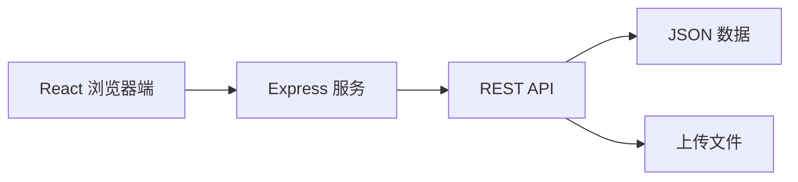

# DHU AILAB HomePage

东华大学人工智能创新实验室网站。本说明面向项目维护者和 Pull Request 贡献者。

## 技术栈

| 模块 | 技术 |
| --- | --- |
| 前端 | React 18、Vite 6、React Router 6 |
| 样式与组件 | Tailwind CSS 3、Radix UI、Framer Motion |
| 后端 | Node.js、Express 5 |
| 数据 | 本地 JSON 文件 |
| 上传处理 | Multer、Sharp、Poppler |
| 测试 | Node.js Test Runner、ESLint、TypeScript Check |
| 部署 | Docker、Docker Compose、GitHub Actions |

开发环境使用 Node.js 22 可与 Docker 镜像保持一致，最低要求 Node.js 18。

## 项目架构

这是一个前后端同仓库、同域名运行的单体全栈应用。



- 开发环境：Express 挂载 Vite 中间件，由 `npm run dev` 启动完整应用。
- 生产环境：Vite 构建到 `dist/`，Express 同时提供前端文件、API 和上传文件。
- 前端统一使用 `/api/...` 相对路径访问后端。
- 运行数据位于 `data/`，不提交 Git。

## 目录结构

```text
DHU-AILAB-HomePage/
├─ src/
│  ├─ api/client.js                 # 前端 API 客户端
│  ├─ components/
│  │  ├─ admin/                     # 管理后台组件
│  │  ├─ members/                   # 成员资料组件
│  │  ├─ motion/                    # 通用动效
│  │  └─ ui/                        # 基础 UI 组件
│  ├─ hooks/                        # React Hooks
│  ├─ lib/                          # 登录、排序、文案和工具函数
│  ├─ pages/                        # 页面组件
│  ├─ App.jsx                       # 路由与全局 Provider
│  └─ index.css                     # 全局样式和设计变量
├─ server/
│  ├─ index.js                      # API、认证、上传和静态服务
│  ├─ store.js                      # 内容存储与数据校验
│  ├─ docs-store.js                 # 招新文档读取与路径校验
│  ├─ member-account-store.js       # 成员账号与密码
│  ├─ member-import.js              # 成员批量导入
│  └─ member-visibility.js          # 成员公开规则
├─ content/recruit/                 # 招新内容的初始数据，仅首次启动时复制到 data/recruit-content
├─ tests/                           # 自动化测试
├─ public/                          # 公共静态资源
├─ data/                            # 运行数据，不提交 Git
├─ Dockerfile                       # 生产镜像
├─ docker-compose.yml               # 容器编排
└─ .github/workflows/               # 自动构建与部署
```

## 前端

### 路由

路由定义在 `src/App.jsx`。

| 路径 | 页面 | 权限 |
| --- | --- | --- |
| `/` | 首页 | 公开 |
| `/members` | 团队成员 | 公开 |
| `/awards` | 科研成果与竞赛获奖 | 公开 |
| `/activities` | 活动 | 公开 |
| `/club-life` | 社团生活 | 公开 |
| `/gallery` | 实验室公共相册与主页照片精选 | 已登录账号 |
| `/contribute/material` | 学习资料上传 | 已登录账号 |
| `/contribute/qa` | 问答补充 | 已登录账号 |
| `/contribute/award` | 竞赛与科研成果上传 | 已登录账号 |
| `/videos` | 视频 | 公开 |
| `/resources` | 学习资料 | 公开 |
| `/ai-guide` | AI 入门指南 | 公开 |
| `/notifications` | 通知 | 公开 |
| `/join` | 加入我们 | 公开 |
| `/recruit` | 招新专区，自动进入本次招新 | 公开 |
| `/recruit/:cohort` | “文档”分栏：某一期招新的总文档 | 公开 |
| `/recruit/:cohort/:slug` | “文档”分栏：单篇文档 | 公开 |
| `/recruit/:cohort/submit` | “提交”分栏：提交表单 | 公开，批次开放时 |
| `/recruit/:cohort/submissions` | “收到的提交”分栏 | 已登录账号 |
| `/recruit/:cohort/submissions/:id` | 某位同学的某个版本，带文件预览 | 已登录账号 |
| `/qa` | 常见问题 | 公开 |
| `/admin-login` | 统一登录 | 公开 |
| `/admin` | 内容管理 | 管理员 |
| `/member-center` | 成员个人中心 | 成员 |
| `/member-password` | 成员修改初始密码 | 成员 |

### 数据请求

所有页面优先通过 `src/api/client.js` 请求数据。该文件负责：

- 统一请求与错误处理
- 同源 Cookie
- 请求超时
- 实体列表短期缓存
- 内容修改后的缓存失效

通用实体调用示例：

```js
const items = await api.entities.Activity.list('-date', 200);
await api.entities.Activity.create(payload);
await api.entities.Activity.update(id, payload);
await api.entities.Activity.delete(id);
```

### UI 约定

- 使用 `@/` 引用 `src/` 下的模块。
- 优先复用 `src/components/ui/` 中的组件。
- 颜色、圆角和字体使用 `src/index.css` 中的设计变量。
- 图片使用项目的 `Image` 组件，并保持原图比例。
- 动效需要支持 `prefers-reduced-motion`。
- 页面修改需要同时检查桌面端和移动端。

## 后端

`server/index.js` 是后端入口，负责：

- Express 和开发环境 Vite 中间件
- 管理员与成员登录
- 实体 CRUD API
- 成员自助资料 API
- 图片和文件上传
- 图片尺寸变体
- 外部资源封面
- 生产环境静态页面和 SPA 回退

### 主要 API

| API | 用途 | 权限 |
| --- | --- | --- |
| `GET /api/health` | 健康检查 | 公开 |
| `POST /api/auth/login` | 登录 | 公开 |
| `GET /api/auth/me` | 当前身份 | 已登录 |
| `POST /api/auth/change-password` | 修改密码 | 成员 |
| `POST /api/auth/logout` | 退出 | 公开 |
| `GET /api/public/members` | 公开成员 | 公开 |
| `GET /api/public/home-photos` | 仅返回主页精选照片 | 公开 |
| `GET /api/public/albums?category=...` | 返回活动或社团生活页面所需的公开相册字段 | 公开 |
| `GET /api/docs/cohorts` | 招新批次列表 | 公开 |
| `GET /api/docs/:cohort/pages` | 某批次的文档目录 | 公开 |
| `GET /api/docs/:cohort/pages/:slug` | 某篇文档的 Markdown 正文 | 公开 |
| `GET /docs-assets/:cohort/*` | 文档引用的图片和附件，Word、PPT 等一律以附件下载；未发布批次的文件仅管理员可访问 | 公开 |
| `GET/PUT /api/admin/recruit/cohorts` | 读取、保存批次设置 | 管理员 |
| `POST /api/admin/recruit/:cohort/publish` | 立即发布；`schedule` 设置定时、`DELETE schedule` 取消、`unpublish` 撤回 | 管理员 |
| `/api/admin/recruit/:cohort/pages[/:slug]` | 文档列表（含草稿）、读取、保存、删除；`POST .../import` 导入 `.md` | 管理员 |
| `/api/admin/recruit/:cohort/assets` | 列出、上传、删除图片和附件 | 管理员 |
| `POST /api/recruit/:cohort/submissions` | 提交 PDF、PPT 或 HTML，每个 IP 每小时最多 10 次 | 公开，批次开放时 |
| `GET /api/recruit/:cohort/submissions` | 提交列表；联系方式仅管理员可见 | 已登录账号 |
| `GET /api/recruit/submissions/:id/file` | 预览或下载提交的文件 | 已登录账号 |
| `DELETE /api/recruit/submissions/:id` | 删除一份提交 | 管理员 |
| `GET /api/entities/:entity` | 查询实体 | 公开读取 |
| `POST /api/entities/:entity` | 新增实体 | 管理员 |
| `PUT /api/entities/:entity/:id` | 修改实体 | 管理员 |
| `DELETE /api/entities/:entity/:id` | 删除实体 | 管理员 |
| `POST /api/admin/member-import` | 成员批量导入 | 管理员 |
| `GET /api/member/profile` | 本人资料 | 成员 |
| `PUT /api/member/profile` | 修改本人资料 | 成员 |
| `POST /api/member/photo` | 上传本人照片 | 成员 |
| `POST /api/upload` | 上传管理内容 | 管理员 |
| `POST /api/album-photos` | 批量上传相册照片 | 已登录账号 |
| `POST /api/albums` | 创建公共相册 | 已登录账号 |
| `PUT /api/albums/:id` | 编辑公共相册 | 已登录账号 |
| `DELETE /api/albums/:id` | 删除本人创建的相册 | 创建者或管理员 |
| `PATCH /api/albums/:id/photos/:photoId/home-featured` | 选择或取消主页轮播照片 | 管理员 |
| `POST /api/contributor-upload` | 上传投稿附件或图片 | 已登录账号 |
| `POST /api/contributions/:entity` | 投稿 `StudyMaterial`、`QA` 或 `Award` | 已登录账号 |

权限必须由后端验证，不能只依赖前端隐藏按钮或路由跳转。

## 招新文档

招新总文档和教程以 Markdown 文件形式保存在服务器的 `data/recruit-content/`，由管理后台的“招新”标签页编辑，**不需要改代码、不需要重新部署**。仓库里的 `content/recruit/` 只是首次启动时的初始数据：`data/recruit-content/` 不存在时复制一次，之后不再读取。

- **批次**：清单在 `cohorts.json`，页面顶部的下拉菜单据此切换。状态有“未发布、本次招新、即将开始、往期”。未发布的批次对访客完全不可见（切换器、文档、附件、提交入口都不可访问），只有管理员能在后台编辑；`/recruit` 自动进入状态为 `current` 的批次。
- **发布**：后台的“立即发布”会把批次设为本次招新，原来的本次招新转为往期，并可同时发布所有草稿文档；“定时发布”设置一个北京时间，到点自动执行同样的操作。定时发布在有人访问时检查并落盘，服务器重启或到点时恰好宕机，也会在下一次访问时补上。
- **修改批次编号**：批次设置里已创建的批次旁有“修改编号”按钮（接口 `PUT /api/admin/recruit/:cohort/rename`），会把文档目录（含图片附件）、批次清单和已收到的提交一起迁到新编号，文档里的图片是相对路径，不用改。网址会随之变化，旧网址失效，所以最好在把链接发给学生之前改。
- **预发布**：后台“预览发布效果”和发布面板里的“预发布”会在新标签页打开 `/recruit/<批次>?preview=1`，按发布后访客看到的样子展示未发布的批次（文档、分组、提交表单），草稿文档带“草稿”标记，页面顶部有预览提示，提交表单在预览里不能提交。只有管理员的会话才生效，访客带上 `?preview=1` 看到的还是普通页面（未发布的批次依然是 404）。接口是 `/api/docs/*?preview=1`，由 `server/docs-store.js` 的 `preview` 选项实现。
- **分组与排序**：批次可以把选择方向（论文）分成若干组（计算机视觉 / 自然语言处理 / 多模态），在“批次设置”里编辑，存在 `cohorts.json` 的 `groups`，每个方向最多属于一个分组，没分组的排在最后。文档在编辑区选“分组”（总文档 `index` 不分组），公开的文档目录、提交表单的方向下拉和“收到的提交”侧栏都按分组归类。文档顺序用左侧列表里的上下箭头调整，只在同一个分组内生效，接口是 `PUT /api/admin/recruit/:cohort/pages-order`（把排序号重写为 10、20、30…）；排序号存在文档的 `order` 里，保存文档时不会被改掉。分组被删除后，原来属于它的文档自动显示为“未分组”。
- **论文锁定**：批次设置里可以填“论文锁定时间”（北京时间）。在这之前同学可以随便换论文，以最后一次提交为准；到点后，已经提交过的同学只能继续提交原来选的那一篇，还没提交过的同学可以选一篇，提交后同样锁定。判断由服务器完成（`server/recruit-submissions.js` 的 `checkDirectionLock`），按学号（不分大小写）识别同一个人，锁定后学号对应的姓名必须和之前的提交一致，否则拒绝。“收到的提交”里同一个学号只算一个人，列在最新一次提交的论文下，换过论文的历史版本都保留。某个同学想改论文，管理员在“收到的提交”里删掉他的提交即可。
- **报名账号**：提交前要先在“提交”页注册报名账号（学号、姓名、年级、专业、密码），同一个学号只能注册一次。这种账号和成员账号完全分开：独立的存储 `data/recruit-applicants.json`（密码用 scrypt 加盐保存）、独立的 cookie（`ailab_applicant`）、独立的角色 `applicant`。`resolveSession` 只认 admin 和 member，所以报名账号的会话进不了任何成员或后台接口，也看不到任何人的提交。表单里的姓名、学号、年级、专业由服务器从账号读取，不看表单里填的值，所以同一个人每次提交的身份一定一致。注册和登录有频率限制；忘记密码由管理员在后台“报名账号”里重置（生成一次性的临时密码），也可以删除账号。
- **提交页**：顶部列出“论文锁定”和“提交截止”两个时间（北京时间，带“还剩 N 天 / 已锁定 / 已截止”），未登录也能看到；表单标出必填项和选填项。登录后能看到“我的提交记录”（只有自己的，接口 `GET /api/recruit/:cohort/my-submissions`），联系方式按上一次提交预先填好；论文锁定后，论文下拉框固定为之前选的那一篇。后台的截止时间、锁定时间和定时发布都用日历加 24 小时制的时、分下拉框选择（`src/components/ui/date-picker.jsx`，基于开源的 react-day-picker），不再手写字符串。
- **报告与代码压缩包**：每次提交有两个文件：必交的报告（PDF、PPT、HTML，不超过 30MB）和选填的“代码与结果”压缩包（只收 .zip，不超过 100MB，会检查文件头）。两个文件按同一个编号命名（压缩包是 `…_v2_代码与结果.zip`），删除提交时一起删除；“收到的提交”里分别下载，导出的名单里有压缩包一栏。上传先写到 `data/recruit-submissions/tmp/` 再移入，不占内存，服务器启动时会清空这个临时目录。限制：报名注册每个 IP 每小时 200 次（只算成功的），每个账号每小时 10 次成功提交，每位同学每期最多 30 次。
- **提交开关**：发布面板里的“开放提交入口”开关立即生效（`PUT /api/admin/recruit/:cohort/submissions-open`）。
- **附件栏**：想放在文档导航最后的文档（报告模版、免费 GPU 教程等），在批次设置里加一个不含论文的分组（如“附件”），再把文档分到这个分组。文档里指向 `.docx`、`.pdf`、`.zip` 等附件的链接，会自动出现在页面底部的“附件下载”列表里；`.tex`、`.bib` 不能直接上传，源文件请打成 `.zip`。
- **公式与流程图**：文档里写 `$行内公式$`、独占一行的 `$$块公式$$`，页面会用 KaTeX 渲染；写 ```mermaid 代码块，页面会画成流程图。两个库都是按需加载的，只有用到公式或流程图的文档才会下载（`src/components/docs/math-plugins.js`、`MermaidDiagram.jsx`），并且是前端库，放在 `devDependencies` 里。后台编辑器也认公式，编辑带公式的文档不会把公式改坏。
- **文章格式**：十篇论文文档统一用同一套格式：一个 H1 标题；“写在前面”；章节“一、”（H2）、小节“1.1”（H3）；代码块语言统一写 `python`、`bash`、`text`；中文和英文、数字之间加一个空格；中文句子里用全角标点；网址写成 `<网址>`；要点句用引用块。统一用 `tools/doc-format.js` 完成（有 `tests/doc-format.test.js`），它只动格式，改完后会校验文字、图片、代码块都和原来完全一致，不一致就不写入。工具是一次性使用的，新文档想套用同样的规则时可以在后台页面里照着用。
- **后台能力**：所见即所得地编辑文档（输入 `/` 选标题、列表、代码块、表格、图片，选中文字出现格式工具栏，直接粘贴或拖入图片即上传并显示；从网页、飞书复制整篇内容粘贴进来时，格式和代码语言会保留，外链图片会自动转存到本站）；也可切换到 Markdown 源码、导入 `.md`；上传图片和附件并插入引用；草稿开关；批次设置（名称、状态、选择方向、提交截止、开放提交）。写操作都经过校验：文档名、文件类型和文件头、路径、大小限制，同名附件不会被覆盖。
- **编辑器**：`src/components/admin/MarkdownEditor.jsx`，基于开源的 [Milkdown Crepe](https://milkdown.dev)（MIT）。存储格式仍是标准 Markdown，所以前台渲染不变。编辑器会按自己的风格重写 Markdown（如无序列表符号 `-` 变 `*`、表格竖线对齐、下划线转义），渲染结果一样；图片的描述文字会转成图注保存。只在管理后台的文档编辑页按需加载，不影响其他页面。
- **读取**：`server/docs-store.js` 读写文件并校验路径；前端 `src/pages/Recruit.jsx` 渲染页面，`src/components/docs/MarkdownContent.jsx` 负责 Markdown（原始 HTML 会被丢弃）。页面是懒加载分包，不影响首页体积。
- **备份**：内容、附件和提交都在 `data/` 下，请整个目录一起备份。写法和日常用法见 `content/recruit/README.md`。

### 页面结构

招新专区仿照 MkDocs Material：顶部是批次切换和分栏（文档、提交、收到的提交），每个分栏有自己的侧边栏。

- **文档**：侧边栏是文档目录，右侧是本页章节目录，底部是附件下载和上一篇、下一篇。
- **提交**：没有侧边栏，只有表单。
- **收到的提交**：登录后才会出现。侧边栏按论文分组列出同学，点谁看谁；同一位同学提交多次时在右侧用版本按钮切换。手机上侧边栏变成下拉选择。

### 提交与审阅

申请人在 `/recruit/:cohort/submit` 填写姓名、学号、年级、专业、选择方向（论文），并至少留一个 QQ、微信或邮箱，再上传文件。只接受 PDF、PPT、HTML，单个文件不超过 30MB。

- **强制命名**：文件统一保存为 `方向_姓名_学号_年级_专业_v版本.扩展名`，不使用上传时的文件名。同一人同一方向再次提交会递增版本号，旧文件不会被覆盖。
- **开放条件**：批次状态为 `current` 且未过 `submission_deadline`。可选项（方向、截止时间）在 `content/recruit/cohorts.json` 配置；年级固定为大一、大二。
- **存放位置**：`data/recruit-submissions/`（索引 `index.json` 与 `files/`），不通过任何公开路径提供，也不在 `/api/entities` 中。
- **权限**：已登录的成员和管理员可以列表、预览、下载；联系方式、导出名单和删除仅管理员。
- **预览**：PDF 使用浏览器内置查看器；PPTX 和 HTML 在浏览器里渲染后，经 DOMPurify 清理，放入没有任何权限、禁止脚本和联网的 `sandbox` iframe；旧版 `.ppt` 只能下载。服务端永远不会把提交的 HTML 以 `text/html` 提供。
- **校验**：除扩展名外还检查文件头，防止改后缀；字段长度、年级与方向白名单、联系方式格式都在服务端校验。

## 管理员与权限

- **超级管理员**：环境变量 `ADMIN_ACCOUNT` / `ADMIN_PASSWORD` 对应的账号，始终存在，不依赖成员数据。
- **成员管理员**：超级管理员在后台“团队成员”里打开某位成员，开启“管理员权限”即可。成员管理员登录后可以使用管理后台编辑网站内容（包括招新），同时保留成员身份（个人中心、改密码照常可用）。
- **权限只在成员改过初始密码之后生效**：成员的初始密码等于学号，容易被猜到，所以改密码之前该账号仍只是普通成员。
- **只有超级管理员**能授予或收回管理员权限，也只有超级管理员能重置、停用、修改其他管理员成员的登录账号或删除他们；成员管理员不能扩散权限。其余管理操作（包括编辑其他管理员的个人资料）成员管理员都可以做。
- 授予或收回后，该成员已有的登录状态会立即失效，需要重新登录；权限每次请求都按最新数据判断，收回即时生效。
- 规则集中在 `server/member-admin-policy.js`，有单元测试覆盖。

## 数据模型

通用实体定义在 `server/store.js` 的 `ENTITY_RULES` 中：

- `Activity`
- `Album`
- `Award`
- `ClubLife`
- `GuideCategory`
- `GuideCourse`
- `GuideStage`
- `HomeImage`
- `Member`
- `Notification`
- `QA`
- `SiteSettings`
- `StudyMaterial`
- `VideoLink`

`Album` 是活动与社团生活共用的内部公共相册。完整相册、创建者信息及其管理界面仅对已登录账号开放；每个相册包含分类、时间、地点、描述和最多 20 张照片，照片通过 `is_home_featured` 标记是否展示在主页轮播。所有已登录账号都可上传和编辑相册，只有管理员可以调整主页精选；删除操作仅限相册创建者或管理员。相册中的照片会按分类公开展示在活动或社团生活页面，公开接口只返回页面展示所需的安全字段，不包含创建者账号或主页精选状态。若尚未精选相册照片，主页会继续使用旧的 `HomeImage` 数据作为兼容回退。

运行数据结构：

```text
data/
├─ site-data.json          # 网站内容和成员资料
├─ member-accounts.json    # 成员账号与密码哈希
└─ uploads/
   ├─ originals/           # 图片原件
   ├─ variants/            # 响应式图片
   └─ ...                  # 优化后的图片和其他文件
```

### 成员公开规则

成员必须满足以下条件才会出现在公开页面：

- 已上传照片
- `profile_status` 不是 `draft`
- `profile_status` 不是 `hidden`

公开规则集中在 `server/member-visibility.js`，不要在其他位置重复实现不同版本。

### 教育与职业经历

`Member.experiences` 按展示顺序保存：

```js
{
  id: '唯一标识',
  type: 'education | work | internship | other',
  start_date: '2022-09',
  end_date: '2026-06',
  is_current: false,
  organization: '东华大学',
  role: '工学学士',
  field: '人工智能',
  description: ''
}
```

## 本地开发

```bash
git clone https://github.com/Ceprin11/DHU-AILAB-HomePage.git
cd DHU-AILAB-HomePage
npm ci
cp .env.example .env
npm run dev
```

Windows PowerShell：

```powershell
Copy-Item .env.example .env
npm run dev
```

默认地址：`http://localhost:3000/`

本地 HTTP 开发时，在 `.env` 中设置：

```env
NODE_ENV=development
PORT=3000
COOKIE_SECURE=false
TRUST_PROXY=false
```

## 常用命令

| 命令 | 用途 |
| --- | --- |
| `npm run dev` | 启动完整开发服务 |
| `npm run build` | 构建前端 |
| `npm start` | 启动生产服务 |
| `npm run typecheck` | 类型检查 |
| `npm run lint` | ESLint 检查 |
| `npm test` | 运行测试 |
| `npm run optimize:uploads` | 优化历史上传图片 |

## 新增依赖放在哪里

Docker 镜像只安装 `dependencies`（构建完成后会 `npm prune --omit=dev`），所以：

- **`dependencies` 只放服务器运行时 `import` 的包**：目前是 `express`、`multer`、`sharp`、`dotenv`、`compression`。
- **其他一律放 `devDependencies`**：前端库（React、Radix、编辑器等）在 `npm run build` 时已经打包进 `dist/`，运行时不需要。
- 在 `server/` 里新增了对某个包的 `import` 时，要把它放进 `dependencies`，否则线上会缺包。

这样生产镜像里的 `node_modules` 约 25MB（原来 500MB 以上），部署时上传很快；如果把前端库放回 `dependencies`，每次改依赖都会重新上传一个很大的镜像层，部署会明显变慢。

## 修改功能时检查哪些文件

### 新增公开页面

1. 在 `src/pages/` 新建页面。
2. 在 `src/App.jsx` 注册路由。
3. 按需修改导航组件。
4. 通过 `src/api/client.js` 获取数据。
5. 添加加载、空数据和错误状态。

### 新增可管理内容

1. 在 `server/store.js` 注册实体或校验字段。
2. 在 `src/pages/Admin.jsx` 配置管理表单。
3. 在公开页面展示数据。
4. 特殊逻辑在 `server/index.js` 添加专用 API。
5. 在 `tests/` 添加测试。

### 修改成员资料

同时检查：

- `src/pages/Admin.jsx`：管理员编辑
- `src/pages/MemberCenter.jsx`：成员本人编辑
- `src/pages/Members.jsx`：公开展示
- `server/index.js`：成员自助编辑白名单
- `server/store.js`：字段校验和兼容处理

### 修改图片或上传逻辑

同时检查：

- `server/index.js` 的上传与图片处理
- `src/components/admin/MediaUpload.jsx`
- `src/components/ui/image.jsx`
- Dockerfile 中所需的系统依赖

## 提交 Pull Request

### 开发流程

```bash
git switch main
git pull --ff-only origin main
git switch -c feat/short-description
```

完成修改后运行：

```bash
npm run typecheck
npm run lint
npm test
npm run build
```

提交并推送分支：

```bash
git add <本次修改的文件>
git commit -m "feat: describe the change"
git push -u origin feat/short-description
```

在 GitHub 创建 Pull Request，目标分支选择 `main`。

### 分支命名

- `feat/...`：新功能
- `fix/...`：错误修复
- `docs/...`：文档
- `refactor/...`：重构
- `perf/...`：性能优化
- `test/...`：测试

### PR 描述

请说明：

- 修改目的
- 主要改动
- 验证方式
- 是否影响现有数据或 API
- 是否新增环境变量
- 界面修改的截图

### 合并前检查

- [ ] 改动范围与 PR 目标一致
- [ ] 没有提交 `.env`、`data/`、日志或临时文件
- [ ] 后端已验证权限和输入
- [ ] 数据结构兼容已有数据
- [ ] 桌面端和移动端显示正常
- [ ] 图片保持原图比例
- [ ] 类型检查、Lint、测试和构建通过
- [ ] README 与代码行为一致

合并到 `main` 会触发 GitHub Actions 自动构建和部署。
